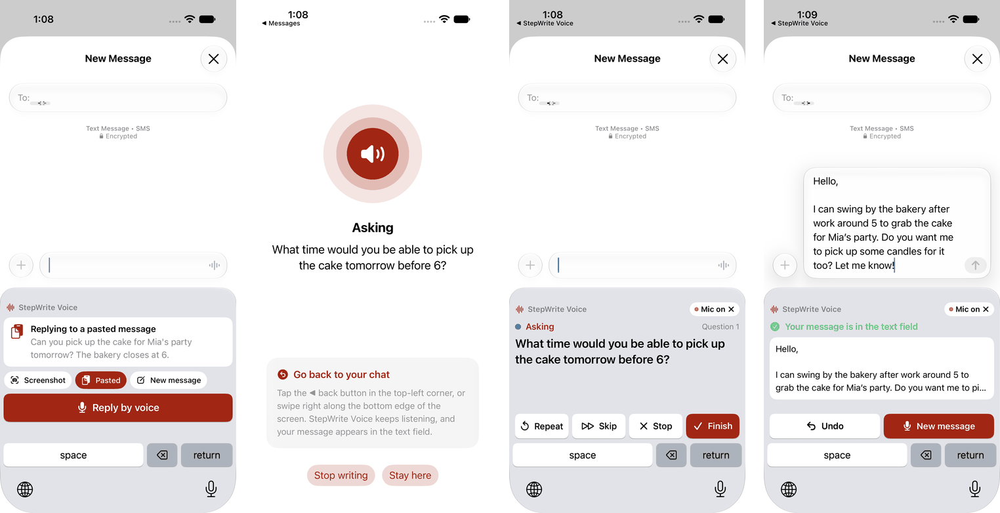
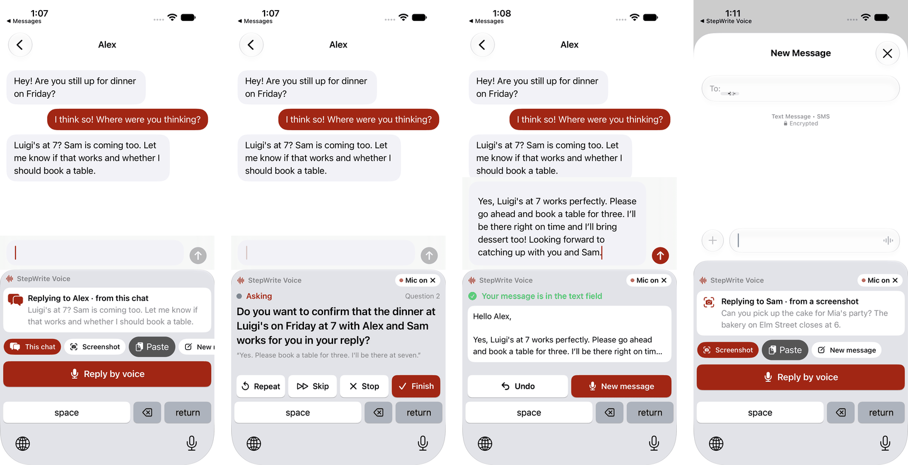
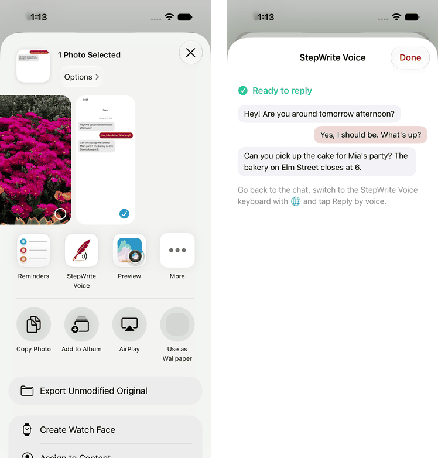
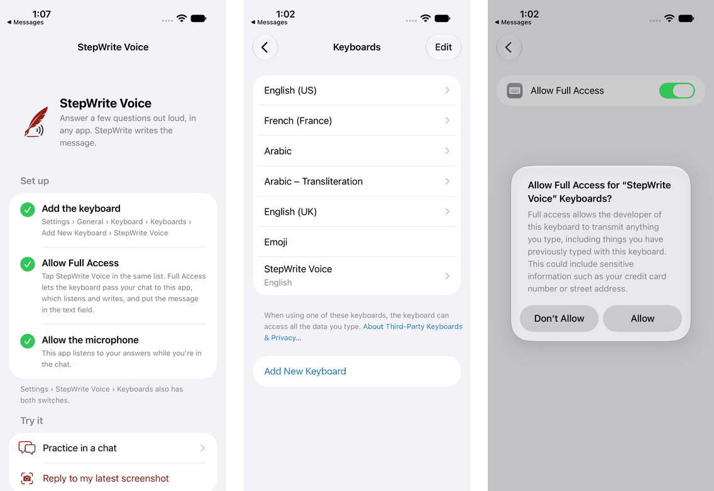

# StepWrite Voice: a keyboard for iPhone

StepWrite's voice flow in any app's text field. In Messages, WhatsApp, Mail or Notes, switch to
the **StepWrite Voice** keyboard and tap **Reply by voice**. It reads short questions aloud, and you
answer them out loud. The finished message then appears in the text field, ready to check and send.
The keyboard knows what you're replying to: the chat you're in, your latest screenshot, a message
you copied, or the text around the cursor.

This is a working proof of concept of StepWrite as a system feature, built for a pitch to Apple.
It builds for any iPhone with iOS 17 or later, and you can install it with a free Apple ID. It
uses the same server endpoints as the web and watch apps, so the server needs no changes.

<p align="center">
  
</p>

## How it works

There are three parts in one Xcode project, [`StepWriteKeyboard.xcodeproj`](StepWriteKeyboard.xcodeproj):

| Part | What it does |
| --- | --- |
| **App** (`App/`) | Listens and speaks. It runs StepWrite's question loop against the server, the same flow as the [watch app](../watch/README.md), and holds setup, a practice chat and Settings. |
| **Keyboard** (`Keyboard/`) | Shows what you're replying to, the question being asked and buttons for Repeat, Skip, Stop and Finish. It puts the finished message in the text field. |
| **Share extension** (`Share/`) | Takes a screenshot or text of a conversation from the share sheet in any app, so the keyboard can reply to it. |

The keyboard and the app talk through an App Group: small JSON files in a shared folder, plus
Darwin notifications that say which file changed ([`Shared/SharedStore.swift`](Shared/SharedStore.swift)).

```
Keyboard (in Messages)                          App
 1. Writes request.json, posts "ping"
                                      ──────▶   2. Microphone on? Posts "pong", reads the request
 3. No pong within 0.5 s: opens
    stepwrite-voice://request         ──────▶   4. Comes forward, turns the microphone on,
                                                   asks the first question
 5. You tap ◀ Messages                            6. Keeps listening in the background
                                      ◀──────   7. After each step, writes session.json and
 8. Shows the question and what it heard           posts "sessionChanged"
 9. Finished: inserts the message
    (textDocumentProxy.insertText)
```

### The microphone

Apple's [App Extension Programming Guide](https://developer.apple.com/library/archive/documentation/General/Conceptual/ExtensibilityPG/CustomKeyboard.html)
says custom keyboards "have no access to the device microphone", so the app does the listening.
iOS also lets an app keep recording in the background, but not start. That's why the first
message opens the app for a moment to turn the microphone on. Tap ◀ in the top-left corner to go
back, and the app listens from the background, with the orange dot showing. After a message the
microphone stays on for 5 minutes (**Settings > Keep the microphone on**, 1 to 30 minutes). So the
next message starts right from the keyboard, with no trip to the app.

That guide was written for iOS 8. In the iOS 27.2 simulator, a keyboard with Full Access *could*
start recording itself: the audio session activated and the input delivered audio. It wasn't
tried on a phone here, so the keyboard doesn't depend on it. If a phone allows it too, the trip
to the app could go.

### What the keyboard can see

The keyboard offers whatever it finds as chips above **Reply by voice**, best first. It sends
the server at most the last 10 messages (3,000 characters), as `originalText` for `/api/reply`.

<p align="center">
  
</p>

| Source | How | In the iOS 27.2 simulator |
| --- | --- | --- |
| **This chat** | iOS 18.4 added [`UIConversationContext`](https://developer.apple.com/documentation/uikit/uiconversationcontext): a messaging app sets the conversation (participants, messages, who sent each one) on its text field, and the keyboard reads it from `textDocumentProxy.conversationContext`. | The practice chat sets it, but iOS doesn't pass it on to this keyboard: `conversationContext` stays `nil` and `conversationContext(_:didChange:)` is never called. So the practice chat also shares its messages through the App Group, which shows what a keyboard could do with them. The keyboard reads the real API first, so it works as soon as iOS passes the conversation on. |
| **Screenshot** | Take a screenshot of the chat, then choose **Screenshot**. The app reads the newest screenshot in Photos with Vision. Bubbles on the left are theirs and on the right are yours, and the name at the top is who you're replying to ([`ScreenReading/ScreenshotReader.swift`](ScreenReading/ScreenshotReader.swift)). | Works |
| **Pasted** | Copy a message, then tap **Paste** on the keyboard. iOS refuses a keyboard's own clipboard reads, even with Full Access ("Operation not authorized"), but the system Paste button hands the text over when tapped. | Works |
| **Shared** | In any app, share a screenshot or text to StepWrite Voice from the share sheet. The extension reads it the same way and shows the messages it found. | Works (a screenshot shared from Photos) |
| **This text** | The text around the cursor (`documentContextBeforeInput` and `documentContextAfterInput`). | Not run here |

<p align="center">
  
</p>

### Full Access

The keyboard asks for Full Access (`RequestsOpenAccess`) because without it, a keyboard can read
the App Group it shares with its app but [can't write to it](https://developer.apple.com/documentation/uikit/configuring-open-access-for-a-custom-keyboard),
so it couldn't send its request. It needs no network of its own: the app talks to the server.
The keyboard has no letter keys and keeps nothing you type. iOS warns that a keyboard with
Full Access could send what you type, which is why the app explains this on its setup screen and
in **How it works**.

## Requirements

- Xcode 26 or later
- An iPhone with iOS 17 or later, or the iOS simulator. Conversations from apps need iOS 18.4.
- The StepWrite server, set up as in the [main README](../README.md#getting-started)

## Run in the simulator

1. Start the server: `npm start` in `server/`.
2. Open `keyboard/StepWriteKeyboard.xcodeproj`, choose the **StepWriteKeyboard** scheme and an
   iPhone simulator, and press **Run**.
3. In the app, follow **Set up**:
   1. In **Settings > General > Keyboard > Keyboards > Add New Keyboard**, add **StepWrite Voice**
      under *Third-Party Keyboards*.
   2. Tap it and turn on **Allow Full Access**.
   3. Allow the microphone.
4. Open **Practice in a chat**, tap the text field, touch and hold 🌐, and choose
   **StepWrite Voice**. Then try it in Messages.

<p align="center">
  
</p>

The simulator reaches the server at `http://localhost:3001`.

### Spoken answers in the simulator

On some Macs the simulator's microphone hears almost nothing. Debug builds for the simulator can
play WAV files into the microphone input instead, one per answer, in name order
([`App/SimulatorAnswers.swift`](App/SimulatorAnswers.swift)). They go through the same silence
detection, transcription and server as a spoken answer:

```bash
mkdir answers && cd answers
say -o 1.wav --data-format=LEI16@16000 "Yes, please book a table for three. I'll be there at seven."
say -o 2.wav --data-format=LEI16@16000 "Tell them I'll bring dessert."
say -o 3.wav --data-format=LEI16@16000 "I would like to stop here."
```

```bash
APP_DATA=$(xcrun simctl get_app_container booted io.github.helalaou.stepwrite.keyboard data)
mkdir -p "$APP_DATA/Documents/SimulatorAnswers" && cp *.wav "$APP_DATA/Documents/SimulatorAnswers/"
```

Used files move to `SimulatorAnswers/Used`. Phones and release builds always use the microphone.

## Install on your iPhone for free

1. **Make the server reachable over HTTPS.** A phone can't reach `localhost` on your Mac. Start
   the ngrok tunnel (see [Remote access with ngrok](../README.md#remote-access-with-ngrok)) and
   put its address in [`App/AppSettings.swift`](App/AppSettings.swift) (`ServerSettings`), or
   enter it later in the app's **Settings**.
2. **Sign the app.** In Xcode, select each of the three targets (**StepWriteKeyboard**,
   **KeyboardExtension** and **ShareExtension**), open **Signing & Capabilities** and choose your
   team. Any Apple ID works, as a Personal Team. If Xcode says an identifier is taken, change
   `BUNDLE_ID_PREFIX` in [`Config/Base.xcconfig`](Config/Base.xcconfig) to one of your own, such
   as `com.yourname.stepwrite.keyboard`. The App Group follows it.
3. **Connect the iPhone** and keep it unlocked. The first time, turn on Developer Mode when asked
   (**Settings > Privacy & Security > Developer Mode**).
4. Choose the iPhone as the run destination and press **Run**, then follow **Set up** in the app.

The project uses only capabilities that a free Apple ID can sign: App Groups, and Background
Modes for audio ([Apple's table](https://developer.apple.com/help/account/reference/supported-capabilities-ios)).
An app signed with a free Apple ID stops opening after 7 days, after which you run it from Xcode
again.

## Builds

GitHub Actions builds the app for iPhone and for the simulator on every push and pull request
(the **iPhone keyboard** job in [`builds.yml`](../.github/workflows/builds.yml)), unsigned like
the watch app. The simulator build, `StepWrite-keyboard-simulator-<version>.zip`, is kept with the
workflow run. It isn't on the releases page.

## The name

**StepWrite Voice** for now. Other candidates were StepWrite Keys, Talk & Write, StepReply and
Speakboard. The name is `KEYBOARD_NAME` in [`Config/Base.xcconfig`](Config/Base.xcconfig).
Changing it there renames the app on the home screen, the keyboard in the keyboard list and
Settings, the share sheet entry and every mention in the app.

## For Apple: what a system-level StepWrite could do

StepWrite helps people write longer messages by voice, hands-free and eyes-free, one question at
a time. As a keyboard it already works in every app. Three changes in iOS would make it seamless:

1. **Give keyboards the conversation.** The plumbing exists. Since iOS 18.4, an app can describe
   the conversation behind a text field with `UIConversationContext`, and a keyboard can read it.
   But in the iOS 27.2 simulator, iOS doesn't pass it on to this keyboard. If iOS passed it to
   keyboards the user has given Full Access, or offered a separate "Allow conversation access"
   switch, replying would take one tap: no screenshot, no copying, no share sheet. This proof of
   concept already reads the API first, and the practice chat shows the result.
2. **A microphone for voice keyboards.** Starting the microphone means a trip to the app today. A
   voice-input permission for keyboards, or a dictation extension point, would keep the whole
   conversation inside the chat.
3. **Open the containing app and come back.** A keyboard has no API to open its own app. This one
   reaches `openURL` through the responder chain, and the user then taps ◀ to return. A
   sanctioned call would make that hop reliable. It could also start the app's audio session
   without leaving the chat.

With these, StepWrite could sit next to dictation in every text field. You'd tap Reply, answer a
few spoken questions, and get a finished message, without looking at the screen.

## Code

| File | Role |
| --- | --- |
| `Config/Base.xcconfig` | The name, bundle identifiers, App Group and link, shared by all three targets |
| `App/StepWriteVoiceApp.swift`, `App/HomeView.swift` | The app, its setup steps and the screen it shows when the keyboard opens it |
| `App/WritingSession.swift` | The question-and-answer loop and its voice commands, shared with the keyboard as `session.json` |
| `App/Microphone.swift`, `App/SpeechRecorder.swift` | The always-on microphone input, and the watch app's silence detection |
| `App/SpeechPlayer.swift` | The server's voice, the device's voice as a fallback, and the sound cues |
| `App/StepWriteAPI.swift` | Calls the server |
| `App/PracticeChatView.swift` | A chat that hands its conversation to keyboards |
| `App/ScreenshotLibrary.swift`, `ScreenReading/ScreenshotReader.swift` | Finds the latest screenshot and reads the chat in it |
| `App/SimulatorAnswers.swift` | Spoken answers from WAV files, in debug builds for the simulator |
| `Keyboard/KeyboardViewController.swift`, `Keyboard/KeyboardModel.swift`, `Keyboard/KeyboardView.swift` | The keyboard |
| `Share/ShareViewController.swift` | The share sheet entry |
| `Shared/` | The shared files, notifications and models |

Voice commands come from the watch app's `VoiceCommand.swift`, which the app builds as well.

## Known limits

- The server's reply prompt writes in a letter style ("Hello Sam, …"), which suits email but is
  long for a chat. A shorter style for messages would be a change to `server/prompts/replyPrompts.js`.
- It was tested in the iOS 27.2 simulator. Before a demo, run it once on a phone to check the
  hop to the app and background listening.
